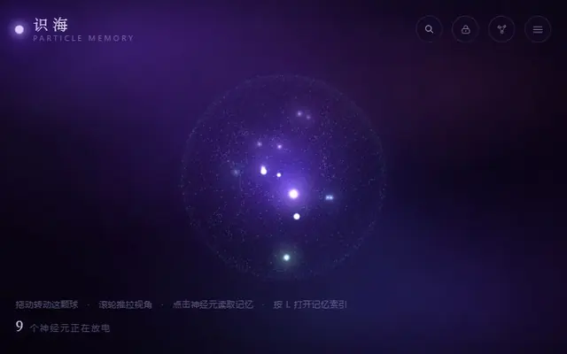

# Thalassa · Particle Memory

[](LICENSE)
[](#highlights)

> A solid orb of light floating in a deep-purple void. Every particle is a memory.
>
> 中文文档 → [README.md](README.md)

**🌐 Live demo: <https://kanxiaohua.github.io/thalassa/>**



<sub>↑ Actual runtime, not a mockup (3.8s, 255 KB WebP)</sub>

An offline, browser-only 3D memory journal. Around 18,000 particles form a solid glowing sphere: a dense particle shell, volumetric interior particles, and dozens of embedded fibre bundles. Each memory is a brighter **neuron** inside the sphere; memories sharing a `tag` cluster into the same "brain region". Click one and the camera dives into the orb while an impulse travels along invisible pathways.

**Pure static HTML/CSS/JS. No build step, no backend, no network, no `npm install`.**

## Run it

```bash
git clone https://github.com/kanxiaohua/thalassa.git
cd thalassa
```

Double-click `index.html`, or serve locally (recommended for the editor page, which uses the File System Access API):

```bash
python -m http.server 8000
# open http://localhost:8000
```

Requires a browser with WebGL support. GitHub Pages also works out of the box (root directory = site root).

## Highlights

- ~18,000 particles in ~13 draw calls; no drawn lines — the "neural" look comes purely from particle density and brightness
- Tag-based brain regions with an index that supports hover, click and keyboard
- Impulse propagation, spontaneous firing, slow heartbeat, periodic potential waves, whispers from long-neglected memories
- `createdAt`-driven decay: older memories grow dimmer, smaller and slower
- Privacy lock screen (PBKDF2 / iterated SHA-256 digest, stored locally), idle and tab-switch auto-lock
- Fully synthesised Web Audio ambience — no audio files, no licensing concerns
- Visual editor (`录入.html`) with photo drag & drop, folder export **and import** (JSON or encrypted `.sea`)
- **Semantic search** (top bar, or press `/`): Chinese TF-IDF computed in-page, zero models, zero network. Hits light up, everything else sinks into the background
- **Semantic star map**: one button re-lays the orb by content similarity instead of `tag`; the transition is a spring-driven morph, not a jump
- **Swappable data layer** (`js/repo.js`): localStorage backend, field sanitising on write, plus AES-GCM sealed export (PBKDF2-SHA256, 2^18 rounds)
- **Memory links**: draw a connection between two memories by hand. The arc follows them across both layouts, impulses travel along it first, and it survives export and the encrypted `.sea` package
- **Timeline replay** (press `T`): the orb rewinds to empty and regrows itself — each memory lights up in its own year while the future stays as a faint shadow. Scrub, pause with `Space`, arrow keys nudge by 2%
- **Tested**: `node --test` — 36 cases covering the semantic algorithms and the data layer, no `npm install` needed
- **Keyboard and screen-reader friendly**: a memory drawer (press `L`) lists every entry as a real button; focus moves into the panel and returns to where it came from; results are announced via `aria-live`. The canvas is decorative — no content is canvas-only
- Works completely offline; Three.js r147 is vendored locally

## Add your own memories

Edit `data/memories.js` (9 fictional sample entries included), or use `录入.html`:

```js
{
  title: "First time seeing the Milky Way",
  text: "That summer we pulled over and killed the headlights...",
  image: "assets/mem-01.svg",
  tag: "Night sky",
  createdAt: "2016-07-18",
  date: "2016 · Summer"
},
```

> **⚠️ Never commit your real memories or private photos to a public repository.**
> See [docs/PRIVACY.md](docs/PRIVACY.md). Photos and audio files are excluded by `.gitignore`.

## Audio & copyright

No audio files ship with this repository. Put audio you have the rights to use into `assets/music/` and run `scan-music.cmd` (Windows) to regenerate `data/music.js`. With no tracks the player quietly falls back to the synthesised ambience.

The lock screen is **a door, not a safe**: memory text stays plaintext in memory and in `data/memories.js`. For content-level secrecy use `SeaRepo.exportSealed('passphrase')`, which derives a 256-bit key with PBKDF2-SHA256 and encrypts the whole JSON bundle with AES-GCM. `录入.html` can import those `.sea` files back.

## Tests

```bash
node --test
```

## License

[MIT](LICENSE) © 2026 kanxiaohua · [Third-party notices](THIRD-PARTY-NOTICES.md)

Sample memories and SVG artwork are original fictional content created for this project.
