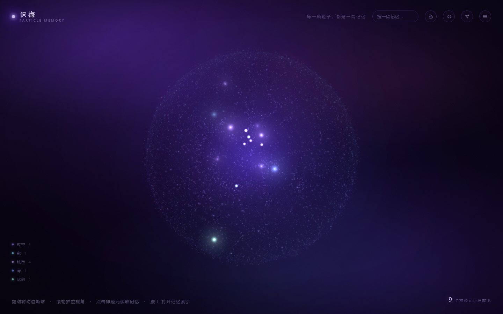
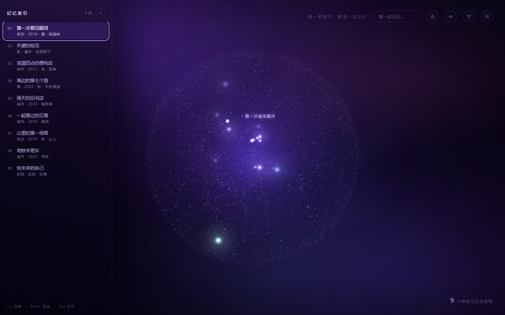

# 识海 · 粒子记忆库

> 深紫虚空里的一颗实心光球。每一颗粒子，都是一段记忆。
>
> An offline, browser-only 3D memory journal built with Three.js. [English →](README.en.md)

**🌐 在线试玩：<https://kanxiaohua.github.io/thalassa/>**



深紫色的虚空里悬浮着一颗由约 1.8 万颗粒子织成的**光球**：球壳是密集的粒子皮，球内塞满体积粒子，还埋着几十条纤维束。你的每一段记忆都是球内一颗更亮的**神经元**——同类的记忆聚在同一束「脑区」里。点开一颗，镜头会钻进球体内部飞到它身边，冲动沿着看不见的通路一路传下去。

**纯静态、零构建、零后端、零联网**。双击 `index.html` 就能在浏览器里运行。

---

## ✨ 特性

| | |
| --- | --- |
| 🧠 **神经光球** | 约 1.8 万颗粒子构成实心球体，全画面不画一根线，「神经」质感完全由粒子密度与亮度做出来 |
| 🗺 **脑区聚类** | 给记忆写 `tag`，同类自动聚成一片锥体；左下角索引悬停时其他区域退暗 |
| ⚡ **放电传播** | 点开记忆时脉冲沿通路扩散，抵达的神经元会跟着亮起并概率性继续下传；平时也有自发放电 |
| ⏳ **时间衰减** | `createdAt` 越久远，神经元越暗、越小、动得越慢，像在遗忘 |
| 🌊 **活着的海** | 球体缓慢心跳、电位波周期扫过、久未被点开的记忆会自己低语出标题 |
| 🔒 **隐私门锁** | PBKDF2 / 迭代 SHA-256 摘要存本地，支持闲置自动上锁、切走标签页上锁、快捷键锁屏 |
| 🔊 **程序化音景** | Web Audio 实时合成低频底噪、五声音阶铃音、气流声；**零音频文件、零版权负担** |
| ✍️ **可视化录入** | `录入.html` 拖照片、填表单、**可导出也可导入**，不用碰代码 |
| 🔍 **语义搜索** | 打几个字就命中，纯前端中文 TF-IDF，不联网、不加载模型；命中亮起、其余沉底 |
| 🌌 **语义星图** | 一键换布局：按内容相似度重新落位，相近的记忆在空间里也挨着，切换是连续动画 |
| 💾 **可替换数据层** | 全部记忆读写走 `SeaRepo` 接口，localStorage 后端 + AES-GCM 加密包，正文不再只有明文 |
| ⌨️ **键盘与读屏可用** | 记忆索引抽屉、面板焦点进出、结果数实时播报——完全不看画面也能读完所有记忆 |
| 🧪 **有测试** | `node --test` 直接跑，语义算法与数据层共 26 个用例 |
| 📴 **完全离线** | Three.js 本地 vendor，不依赖 CDN、npm、构建工具或任何服务 |

---

## 🚀 快速开始

### 方式一：直接双击（最快）

把仓库克隆或下载下来，双击根目录的 `index.html`。需要支持 WebGL 的现代浏览器（Chrome / Edge / Firefox / Safari 均可）。

```bash
git clone https://github.com/kanxiaohua/thalassa.git
cd thalassa
# 然后双击 index.html
```

### 方式二：本地 HTTP 服务（推荐，录入页需要）

`录入.html` 的「导出到文件夹」用了 File System Access API，在 `http://localhost` 下最稳定：

```bash
python -m http.server 8000
# 打开 http://localhost:8000
```

### 方式三：在线直接看

已经部署在 GitHub Pages 上，不用装任何东西：

**<https://kanxiaohua.github.io/thalassa/>**

仓库根目录就是静态站点，fork 后在 Settings → Pages 选择 `main` / `root` 也能得到一份自己的。

> ⚠️ **Pages 是公开的**。只部署示例数据，不要把真实回忆放上去——详见 [隐私说明](docs/PRIVACY.md)。

---

## 📁 目录结构

```
thalassa/
├── index.html                 页面骨架（双击这个）
├── 录入.html                   可视化录入 / 编辑记忆
├── 使用说明.md                 面向使用者的详细手册
├── css/style.css              视觉样式
├── js/
│   ├── main.js                光球 · 神经纤维 · 放电 · 交互 · 面板 · 搜索
│   ├── repo.js                数据层 SeaRepo（localStorage / 导入导出 / AES-GCM）
│   ├── semantic.js            语义层 SeaSemantic（中文 TF-IDF · 检索 · 聚类 · 投影）
│   ├── audio.js               程序化音景（Web Audio 合成）
│   ├── lock.js                隐私门锁
│   └── music.js               背景音乐播放器（文件缺席时静默降级）
├── data/
│   ├── memories.js            ★ 记忆数据（仓库内为 9 条示例）
│   ├── memories.example.js    示例数据备份，随时可还原
│   └── music.js               背景音乐清单（默认空）
├── assets/
│   ├── mem-01.svg … 09.svg    9 张原创 SVG 占位图
│   └── music/放这里.txt        放音频的说明
├── vendor/three.min.js        Three.js r147（MIT，本地 UMD）
├── test/                      单元测试（node --test）
├── scan-music.cmd / .ps1      扫描音频并生成 data/music.js（Windows）
└── docs/
    ├── PRIVACY.md             隐私与数据边界说明
    ├── hero.jpg               README 截图：光球
    └── keyboard.jpg           README 截图：记忆索引
```

---

## 🔍 搜索与语义星图

顶栏的搜索框（或直接按 `/`）是纯前端的中文语义检索：没有模型文件、没有网络请求，靠
`js/semantic.js` 现场切二元词、算 TF-IDF 权重和余弦相似度。

- 输入即搜，命中的神经元亮起、其余沉到底色里；底部计数会变成「N 段记忆命中」
- `Enter` 直接打开最相关的那一条，`Esc` 清空
- 阈值做了两道：绝对下限 0.05，再砍掉低于最高分 35% 的噪声尾巴——中文二元分词偶尔会靠一个通用字凑分

点顶栏那个「相连的圆点」按钮，可以在两种排布之间切换：

| 布局 | 依据 | 效果 |
| --- | --- | --- |
| 标签布局（默认） | 你手写的 `tag` | 同类记忆聚成一个球面锥体，和左下角索引一一对应 |
| 语义布局 | 内容相似度 | 由 `SeaSemantic.project()` 投影到球内，语义相近的挨在一起；越"哪类都不属于"的记忆埋得越深 |

切换时位置不是瞬移——`simulate()` 里的弹簧会把粒子荡到新家，所以是一段连续的形变动画；
纤维连接也会重建，放电改走新的邻接关系。

> 语义布局下左下角索引的悬停高亮只作用于神经元本身，不再给背景尘雾分区染色，
> 因为脑区锥体和语义分组已经不是一回事了。

---

## ⌨️ 键盘操作与无障碍

画面是 canvas，读屏软件读不出任何一个字。所以每条记忆都有一个**等价的文本入口**：
顶栏最右边的列表按钮，或者直接按 `L`，弹出「记忆索引」。



| 按键 | 作用 |
| --- | --- |
| `L` | 打开 / 关闭记忆索引 |
| `↑` `↓` `Home` `End` | 在索引里移动 |
| `Enter` | 阅读当前选中的记忆 |
| `Esc` | 关闭面板（焦点回到刚才那一条），再按一次关闭索引 |
| `/` | 聚焦搜索框 |
| `←` `→` | 面板打开时翻上一张 / 下一张照片 |

几个具体做法，不是"加了几个 aria-label"了事：

- **焦点是闭环的。** 打开面板时焦点送进面板，`Tab` 在面板内循环；关闭时焦点回到你刚才所在的那一条
  记忆，不会掉到页面开头。索引关闭时整块 `inert`，`Tab` 不会钻进看不见的面板。
- **状态会被播报。** 搜索命中数、打开了哪一条、按下了哪个脑区，都通过 `aria-live` 读出来。
- **脑区索引是真按钮。** 可以 Tab 到、可以 Enter 按下（`aria-pressed`），鼠标点一下也能钉住某个脑区只看它。
- **动效尊重系统偏好。** 开了「减弱动态效果」后，抽屉与面板的过渡降到 1ms，极光与噪点动画停掉。

---

## ✍️ 写入你自己的记忆

最简单的方式是双击 `录入.html`：左边是现有记忆，右边填标题 / 日期 / 分区 / 正文、拖入照片，点「导出到文件夹」即可。

也可以直接改 `data/memories.js`：

```js
{
  title: "第一次看见银河",
  text: "那年夏天，我们把车停在国道旁……",
  image: "assets/mem-01.svg",     // 或 images: ["a.jpg", "b.jpg"] 多图
  tag: "夜空",                    // 同 tag 聚成一个脑区
  createdAt: "2016-07-18",       // 影响明暗与快慢
  date: "2016 · 夏 · 国道旁",     // 面板上的小字
  color: "#9b7bff",              // 可选
  size: 1                        // 可选，0.8 ~ 1.8
},
```

存盘、刷新即可。字段全表见 `data/memories.js` 顶部注释。

> ### ⚠️ 提交前必读
>
> `data/memories.js` 里将是**你的真实回忆**，照片会是**你的真实照片**。这些绝不能 `git commit` / `git push` 到公开仓库。
> 完整做法（本地忽略、误提交后的处理）见 **[docs/PRIVACY.md](docs/PRIVACY.md)**。
> 快速做法：
> ```bash
> git update-index --skip-worktree data/memories.js
> ```
> 照片与音频已被 `.gitignore` 默认排除。

---

## 🎵 背景音乐与版权

仓库**不附带任何音频文件**，因为受版权保护的录音不能随开源项目分发。

想加音乐：把**你有权使用的**音频放进 `assets/music/`，双击 `scan-music.cmd`（会生成 `data/music.js`）。支持 mp3 / m4a / aac / flac / wav / ogg / opus。没有音频时播放器安静退出，不影响画面。

不想操心版权？项目自带的程序化音景是实时合成的，不含任何采样：在 `index.html` 的 `js/main.js` 之前加一行即可开启——

```html
<script>window.SOUND_AMBIENCE = true;</script>
```

---

## 🔒 隐私边界（说清楚）

门锁是**一道门，不是保险箱**。短语只挡得住「随手打开你电脑的人」：页面加载的记忆正文在内存里仍是明文，懂技术的人看 localStorage 或 `data/memories.js` 就能读到。短语本身只以摘要形式存在浏览器本地，不存明文、不上传。

真正需要"内容级加密"的场景，用数据层的加密导出：`SeaRepo.exportSealed('短语')` 会用
PBKDF2-SHA256（2^18 轮）派生出 256 位密钥，再用 AES-GCM 加密整包 JSON，产出 `.sea` 加密包。
没有短语就只是密文。`录入.html` 的「导入」按钮可以直接打开这种包。

详见 [docs/PRIVACY.md](docs/PRIVACY.md)。

---

## 🛠 技术实现

- **Three.js r147**（本地 UMD，随仓库分发，MIT）+ 原生 GLSL 发光着色器；
- 粒子云（球壳 + 球内 + 内部纤维）合并为 1 个 draw call，记忆粒子 2 个，全场景约 13 个 draw call；
- 连通关系只用于脉冲传播，不画线、不每帧重建线段；
- 进球内后近处粒子自动淡出、核光与薄壳隐去；高分屏 pixelRatio 上限 2；连续掉帧自动降级渲染分辨率；切到后台暂停渲染；
- 调参集中在 `js/main.js` 顶部的 `CFG`；
- **数据层** `js/repo.js`：`list / upsert / removeAt / save / exportJSON / importJSON / exportSealed / importSealed / reset` 一套接口，浏览器用 localStorage 后端，环境不支持时自动退回只读的 `memories.js`；写入前统一清洗字段，脏数据不会把渲染打崩；
- **语义层** `js/semantic.js`：中文二元分词 + TF-IDF + 余弦相似度，另含 k-means 聚类与力导向 3D 投影，全部纯 JS，零依赖零模型；
- **测试**：`node --test`，覆盖分词、检索排序、阈值、聚类确定性、投影边界，以及数据层的往返、清洗、加密包（含错误短语与坏文件）。

```bash
git clone https://github.com/kanxiaohua/thalassa.git && cd thalassa
node --test
```

不需要 `npm install`——用的是 Node 内置的 test runner 和 webcrypto。

调试模式：地址后加 `?debug=1`，控制台可用 `__sea.state()` / `__sea.fire(i)`，另有 `&sel=3`、`&dist=3&instant=1`、`&settle=1`、`&tide=2000`、`&whisper=1000` 等参数，详见原 `README` 历史说明。

---

## 🗺 路线图

已经做完的：

- [x] 可替换数据层（`SeaRepo`）+ 本地持久化 + AES-GCM 加密包
- [x] 纯前端中文语义检索与语义星图布局
- [x] 录入页导入（补上只能导出不能导入的单向门）
- [x] 键盘可达与读屏支持

接下来想做的：

- [ ] **手势操作**：MediaPipe Hands 接摄像头，张开推开、握拳拉近、捏合选中。目前交互限于鼠标/触摸/键盘
- [ ] **时间轴回放**：按年份推进，粒子依次亮起、变暗、消散，把"时间衰减"从静态参数变成可播放的一段
- [ ] **记忆之间的显式连接**：现在纤维只表示空间邻近，还没法手工连"这两段是一件事"
- [ ] **CI**：把 `node --test` 挂到 GitHub Actions，目前测试只在本机跑

> 路线图不是承诺。这个项目的第一目标是「一个人能看懂、能改」，功能再多也不该让它变成一堆需要配置的东西。

---

## 🤝 贡献

欢迎 Issue 与 Pull Request，尤其是性能、可访问性、移动端适配和文档翻译。请先读 [CONTRIBUTING.md](CONTRIBUTING.md)——里面有一条硬性要求：**提交前确认没有夹带任何私人数据或音频文件**。

---

## 📄 许可证

[MIT](LICENSE) © 2026 Thalassa contributors

第三方依赖与素材见 [THIRD-PARTY-NOTICES.md](THIRD-PARTY-NOTICES.md)。示例记忆文案与 SVG 占位图均为本项目原创虚构内容，不对应任何真实人物或事件。
